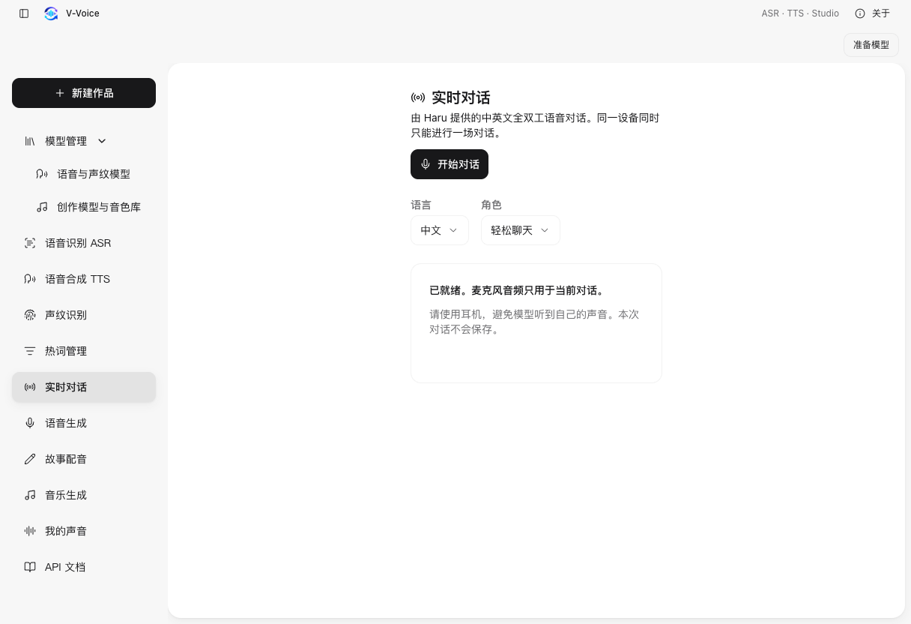
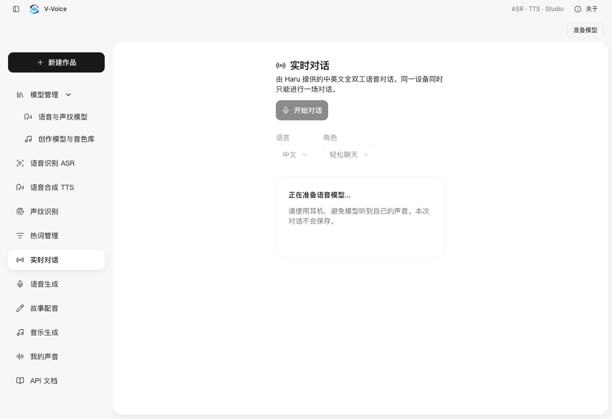
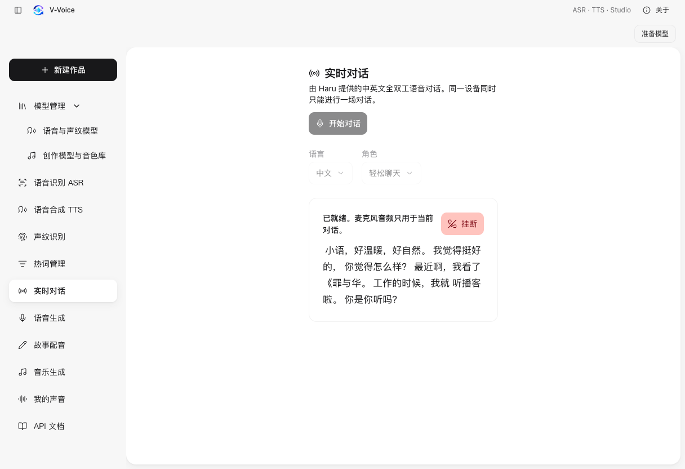
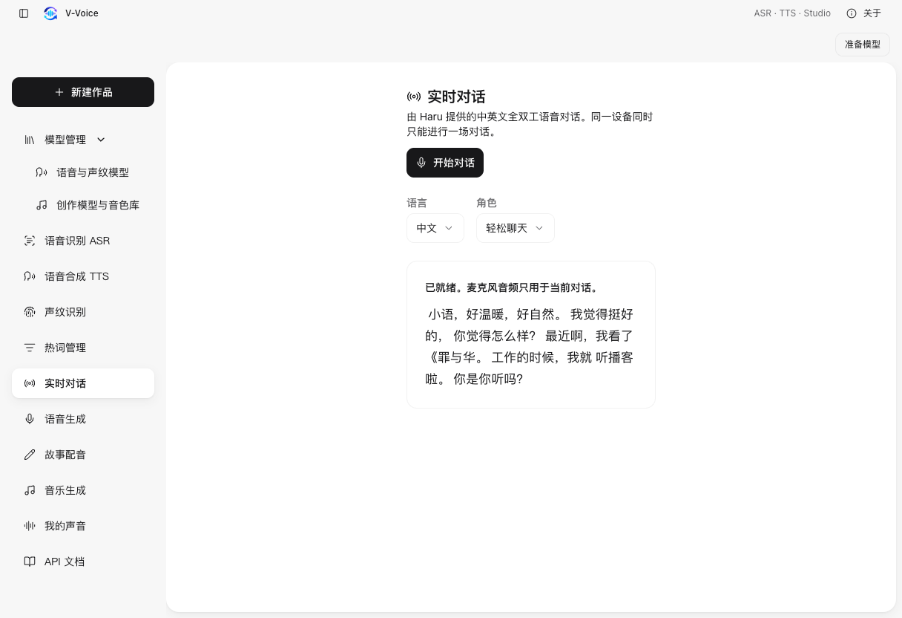

# 实时对话演示案例：和 Haru 聊一分钟

> 真实 VOS 会话，2026-11-27，tc232（AMD CUDA），V-Voice `amd_cu128_0.0.40`。用户侧台词由中文语音合成；Haru 的回复为模型真实输出，未改写内容。

## 一句话

在 VOS 应用抽屉里打开 V-Voice，选择“中文 / 轻松聊天”，点“开始对话”，不用准备提示词，直接说话即可。Haru 会以语音回应，页面同步显示它的转写；挂断后模型热保留 2 分钟，再自动卸载。

## 适合谁

- 想快速体验全双工语音对话的人
- 产品演示、客户体验：不用下载模型，不用额外客户端
- 语言练习前的热身、日常闲聊；也可以切换到“语言练习”或“面试练习”

## 实测环境

| 项目 | 值 |
| --- | --- |
| 设备 | tc232，RTX 5880 Ada，49 GB 显存 |
| 应用 | `v-voice:amd_cu128_0.0.40`，VOS 正常安装 |
| 调度 | V-Scheduler `amd_20261127_voice042cal_37e7799` |
| 会话 | 中文 / 轻松聊天 / 4 轮（8 句） |
| 结果 | 会话 61.6 s；挂断后 `ready_idle`，122 s 后 `unloaded` |

## 体验路径

1. 在 VOS“应用抽屉”里打开 V-Voice。
2. 左侧选择“实时对话”。
3. 语言选“中文”，角色选“轻松聊天”。
4. 点击“开始对话”，首次使用允许麦克风权限。
5. 直接说话；页面显示 Haru 的转写，底部可随时“挂断”。
6. 挂断后回到“已就绪”；模型按设置热保留，空闲到期自动卸载。









注：加载态截图为同版本界面；对话与延时数据来自 2026-11-27 的同一轮实测会话。

## 演示提示卡

- 开场：你好呀，今天过得怎么样？
- 话题一：我周末想去公园散步，你觉得怎么样？
- 话题二：最近有什么轻松一点的电视剧推荐吗？
- 话题三：工作累了的时候，你一般怎么放松？
- 收尾：好呀，那我试试看，谢谢你。

> 本次实测使用前 4 句；最后一句收尾可选。

## 真实对话节选

| 用户（演示脚本） | Haru（真实回复） |
| --- | --- |
| 你好呀，今天过得怎么样？ | 小语，好温暖，好自然。 |
| 我周末想去公园散步，你觉得怎么样？ | 我觉得挺好的，你觉得怎么样？ |
| 最近有什么轻松一点的电视剧推荐吗？ | 最近啊，我看了《罪与华。 |
| 工作累了的时候，你一般怎么放松？ | 工作的时候，我就听播客啦。你是你听吗？ |

说明：页面只显示 Haru 的转写，用户台词来自演示脚本；上表来自页面转写，只整理了多余空格，未改写内容。第一轮 Haru 先评价了声音，没有直接回答“今天过得怎么样”，这是本次真实会话的表现；如果要更直接的回答，可以把问题说得更具体，例如“你今天心情怎么样？”。

## 实测数据

- 热模型加载：1.38 s（本次复用了刚结束会话的模型；调度器重装后的首次启动实测 19.7 s，设计上限 90 s）
- 会话时长：61.6 s，4 轮
- 第 2–4 轮首帧语音延迟：0.48–1.31 s（第 1 轮与开场问候重叠，未计入范围）
- 挂断后状态：`ready_idle`
- 空闲卸载：122 s 后 `unloaded`（默认 120 s）
- 同设备并发：只允许 1 场对话；第二场会提示忙碌，不排队

## 为什么适合做演示

- 入口在 VOS 应用内，不需要额外客户端或 API Key。
- 模型由 V-Scheduler 按需加载，演示前不用手动准备。
- 真正的全双工语音：可以自然停顿、接话，Haru 会按自己的节奏回应。
- 页面不保存音频和对话文本；适合在受控环境里做体验。

## 限制

- 用户侧是合成语音，不代表真人麦克风/耳机条件下的全部效果；正式演示建议用耳机，避免扬声器回声。
- Haru 的回复偏短、偏陪伴式；不适合要求强任务完成度的场景，例如查资料、连续执行指令。
- 页面只显示 Haru 的文字，不显示用户侧转写；需要完整对话记录时，用演示脚本的台词配对。
- 首次冷启动受磁盘和 GPU 影响，可能明显慢于热加载；本次测试机冷读约 33 MB/s。
- 模型未安装、profile 不支持或设备忙时，入口会禁用或提示；AMD CPU、ARM CPU、通用 ARM CUDA 不显示入口。

## 复现

```bash
# 在 V-yovoice 仓库根目录
node scripts/dialogue-demo-case.mjs --launch --clip-limit 4 --max-seconds 130

# 或者复用已登录的 VOS 浏览器
node scripts/dialogue-demo-case.mjs --cdp http://127.0.0.1:9222 --clip-limit 4 --max-seconds 130
```

首次用 `--launch` 会弹出浏览器，需要手动登录 VOS；登录态只保存在本机缓存目录，不写入仓库。

- 合成语音：`scripts/fixtures/dialogue-demo-clips.json`（5 句，24 kHz 单声道 16-bit）
- 合并 WAV：`scripts/fixtures/dialogue-demo-user-24k.wav`
- 原始证据：`docs/images/dialogue-demo/evidence.json`

## 结论

实时对话已经具备“打开就能聊”的演示体验：入口浅、无需下载、语音延迟在一秒左右，挂断后资源能按预期释放。当前更适合轻松聊天、语言/面试练习和产品体验；如果要做强任务型对话，需要更明确的角色提示和更完整的对话管理。
