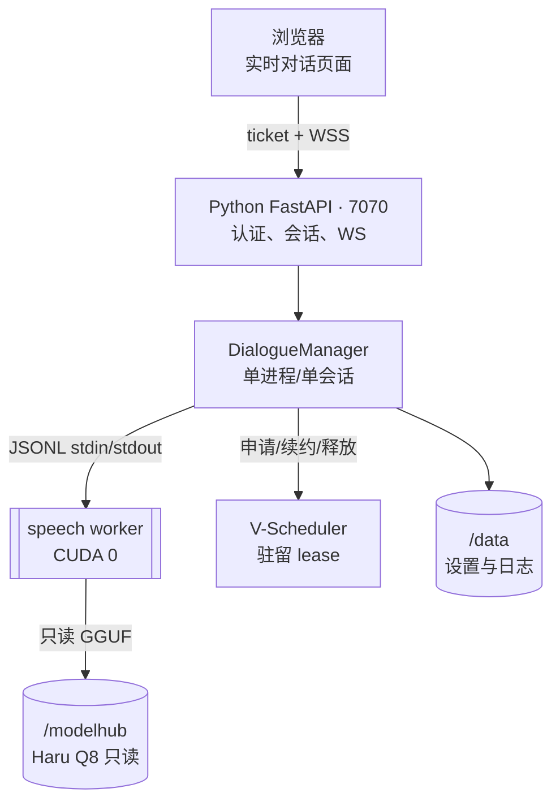

# Haru 实时对话集成设计

状态：已实现；`amd-cuda`、`l4t` 与 `thor` 已适配
适用范围：VOS `amd-cuda`、`l4t` 与 `thor` profile
推理后端：`speech.cpp` 0.11.0 / Haru-4B Q8_0 / CUDA 0
日期：2026-11-16；2026-11-22 更新 AMD CUDA / Thor

本文确定 V-Voice 集成 Haru 全双工对话的边界、生命周期和跨应用契约。首版随 `0.0.38` 在 l4t/tc207 发布；`amd-cuda` 与 `thor` 随后使用各自的 CUDA 架构构建并开放。

## 1. 结论

V-Voice 将 Haru 做成应用内的独立实时对话能力：

- `amd-cuda`、`l4t` 与 `thor` 的 VOS 用户可见，同一设备同时只允许一个 Haru 会话。
- 使用 `speech worker` 作为同容器子进程，不使用 Vulkan，也不开放 speech.cpp 的网络端口。
- 首个会话按需加载模型；默认会话结束后热保留 120 秒，随后卸载。保留时间由管理员在设备级设置中调整。
- 模型由 V-Scheduler 下载到共享目录，V-Voice 只读读取；模型权重不打进镜像。
- 浏览器只连接 V-Voice 自有、经过 VOS 身份校验的 WebSocket；speech.cpp 只通过 stdin/stdout 与 V-Voice 通信。
- 首版仅支持中文、英文和中英文固定角色卡，不支持用户音色克隆、普通 TTS/ASR 接入或断线续聊。

## 2. 已确认决策

| 决策 | 结果 |
| --- | --- |
| 交付阶段 | 0.0.38 完成 L4T 首版；0.0.40 增加 AMD CUDA 与 Thor |
| 用户范围 | 所有 VOS 用户可用 |
| 并发 | 单设备单 Haru 会话，其他请求返回忙碌，不排队 |
| 模型生命周期 | 首次懒加载；挂断后默认热保留 2 分钟，可配置 |
| 首版功能 | 中英文 Haru 全双工对话；不做 TTS/ASR；不做音色克隆 |
| 模型交付 | V-Scheduler 下载到共享目录，V-Voice 只读挂载 |
| 网络边界 | 浏览器只连 V-Voice 认证 WebSocket；speech.cpp 仅父进程管道 |
| 调度 | 扩展 V-Scheduler，表达模型驻留和原生进程退出 |
| 会话限制 | 默认 3 分钟，硬上限 5 分钟，静音或异常 15 秒结束 |
| 角色 | 固定预设角色卡，不开放自由文本 Persona |
| 数据 | 不保存音频和对话文本，仅记录脱敏运行元数据 |

## 3. 非目标

- 不把 Haru 纳入现有 OpenAI 兼容 `/v1/audio/*`，Haru 不是普通 TTS。
- 不在 AMD CPU、ARM CPU、通用 ARM CUDA 等未适配 profile 上承诺运行；这些 profile 不显示入口。
- 不替换 audio.cpp、sherpa-onnx、现有 TTS、ASR 或声纹流程。
- 不保留实时音频、对话文本、会话录制或用户音色文件。
- 不支持多会话并发、会话迁移、断线恢复或后台自动重连。
- 不使用 Vulkan sidecar；当前 `v-voice:l4t_0.0.37` 的 24.04 用户态与 L4T 540.4 Vulkan ICD 不兼容。

## 4. POC 基线

已在真实 `swr.cn-southwest-2.myhuaweicloud.com/ictrek/v-voice:l4t_0.0.37` 镜像内验证：

- `speech worker` 和 `speech serve` 的 CUDA 二进制均能识别 `CUDA0`。
- Haru Q8_0 文件大小 `6,623,102,720` 字节，SHA-256 为
  `c372a527e63ca4251429a48863535b8bca03ebd6f414bbf31f28a9d175349934`。
- CUDA 后端可加载模型并生成真实语音；测试回复为
  “Oh hello, I am Haru. It's”。
- 10 轮、120 帧的热身后计时：`p50 126.5–128.7 ms`，
  `p99 127.4–133.6 ms`，`1/120` 次超过 133 ms，`RTFx 1.04–1.05`。
- 服务模式下 `/health` 和 `/v1/models` 可返回，但 `/health` 不代表模型已经加载。
- 模型加载约 11–14 秒；会话结束后 V-Voice 主容器仍健康，临时容器已清理。

未验证项：10 分钟连续会话、与 VOS 其他容器并发、热降频、V-Scheduler 租约、正式镜像内构建和浏览器完整链路。设计不应把 POC 结果表述为发布验收。

### 0.0.40 实机验证

2026-11-22 在正式 VOS 安装流程内验证：

- tc232 / `amd-cuda`：RTX 5880 Ada，SM 8.9；`amd_cu128_0.0.40` 使用
  `80-real;86-real;89-real;90-real`。真实 Haru worker 加载 `6116 ms`，生成
  4 帧 / 12800 samples；VOS WebSocket 再完成 4 帧并正常 `end`。
- tc229 / `thor`：Thor，SM 11.0 / CUDA 13.2；`thor_0.0.40` 使用 `110-real`。
  真实 Haru worker 加载 `9338 ms`，生成 4 帧 / 12800 samples；VOS WebSocket
  再完成 4 帧并正常 `end`。
- tc207 / `l4t`：Orin，SM 8.7；`l4t_0.0.40` 使用 `87-real`。真实 Haru worker
  加载 `15360 ms`，生成 4 帧 / 12800 samples；VOS WebSocket 再完成 4 帧并正常
  `end`。
- 三台设备均通过 VOS 正常升级到 `0.0.40`，`runtime_ready=true`，依赖
  V-Scheduler `0.0.120`；结束后 `/api/v1/dialogue/status` 均为
  `supported=true`、`model_installed=true`、`state=ready_idle`。
- 空闲 120 秒后设备均回到 `state=unloaded`，容器内无 `speech` 进程，
  `residency.json` 已清除，确认热保留到期会释放 worker 和驻留许可。
- tc232 在其他 GPU 任务共存时另有一次 `38754 ms` 冷启动；90 秒启动上限内正常
  完成会话。
- 三次会话均使用同一固定模型：`6,623,102,720` 字节，
  SHA-256 `c372a527e63ca4251429a48863535b8bca03ebd6f414bbf31f28a9d175349934`。

2026-11-23 使用仓库内 `scripts/haru_dialogue_smoke.py` 对三台设备上的 `0.0.40`
镜像复验：tc232、tc229、tc207 均完成真实 worker 加载、6400 字节首帧、正常
`end`、worker 退出码 0、无孤儿进程和驻留状态清理；每台各生成 17 帧。

本轮验证覆盖镜像构建、CUDA 链接、真实模型加载、VOS 身份、Scheduler 驻留许可和
WebSocket 全链路；不覆盖 10 分钟持续会话、多会话并发、热降频和断线恢复。

## 5. 总体架构



### 进程职责

| 组件 | 职责 |
| --- | --- |
| 浏览器 | 采集 24 kHz PCM、播放模型帧、显示会话文字和状态 |
| Python FastAPI | VOS 身份、ticket、WebSocket、会话状态、worker 监管、Scheduler 适配 |
| DialogueManager | 加载/预热/空闲卸载、单会话互斥、worker 崩溃清理、帧延迟判定 |
| speech worker | 加载一个 Haru 模型，执行串行 `dialogue`、`chunk`、`hang_up`、`cancel` |
| V-Scheduler | 模型下载、驻留 lease、资源准入和原生退出确认 |
| V-Scheduler 共享目录 | 只读提供 GGUF；worker 不自行下载模型 |
| Go `vvoice-studio` | 保持现状，不承载 Haru 会话 |

## 6. 公共接口

所有接口位于 V-Voice 同源 API 下，浏览器不直接访问 speech.cpp。

### `GET /api/v1/dialogue/status`

返回脱敏的公共状态：

```json
{
  "supported": true,
  "model_installed": true,
  "state": "ready_idle",
  "busy": false,
  "idle_unload_seconds": 120,
  "model": {
    "key": "haru-4b-q8",
    "name": "Haru-4B Q8_0",
    "languages": ["zh", "en"]
  }
}
```

`state` 为 `unloaded`、`loading`、`ready_idle`、`active`、`unloading`、
`unavailable` 或 `error`。不返回路径、令牌、用户信息或进程 PID。

### `POST /api/v1/dialogue/tickets`

需要 `Authorization: Bearer <VOS user token>`。请求绑定会话参数：

```json
{
  "language": "zh-CN",
  "persona_id": "companion",
  "max_seconds": 180
}
```

返回一次性 ticket：

```json
{
  "ticket": "...",
  "expires_at": "2026-11-16T12:34:56Z",
  "ws_path": "/api/v1/dialogue/ws"
}
```

- ticket 使用 256 位随机数，服务端只保存摘要。
- TTL 5 分钟、单次使用，绑定 VOS `sub`、设备、语言、角色和 `max_seconds`。
- 不记录 ticket 原文或 query string；日志只记录 ticket id 的摘要。
- 模型未安装返回 503 `model_unavailable`；设备忙返回 409 `dialogue_busy`；
  Scheduler 无资源返回 429 `dialogue_capacity_unavailable`。

### `WS /api/v1/dialogue/ws?ticket=...`

WebSocket 只接受同源连接，ticket 校验后立即作废。协议版本 1：

客户端：

| 类型 | 内容 |
| --- | --- |
| 文本 | `{"type":"start","protocol":1}` |
| 二进制 | 24 kHz、16-bit little-endian、单声道 PCM，长度任意 |
| 文本 | `{"type":"hang_up"}` |

服务端：

| 类型 | 内容 |
| --- | --- |
| 文本 | `{"type":"loading","phase":"model"}`（需要冷加载时） |
| 文本 | `{"type":"started","protocol":1,"sample_rate":24000,"frame_samples":3200,"max_seconds":180}` |
| 文本 | `{"type":"text","text":"..."}`，对应下一帧模型音频 |
| 二进制 | 24 kHz、16-bit little-endian、单声道 PCM，每帧 3200 samples |
| 文本 | `{"type":"end","reason":"complete","frames":N,"samples":N}` |
| 文本 | `{"type":"error","code":"...","message":"..."}`，随后关闭 |

约束：

- `started` 之前收到的二进制音频以 1008 关闭。
- 客户端必须按 24 kHz 发送；不在服务端做多采样率兼容，前端负责采集和重采样。
- 单次会话最多约 14.4 MB 输入音频，服务端另设 16 MiB 上限。
- 没有音频输入且没有模型输出超过 15 秒，服务端以 1000 关闭并释放会话。
- 正常 `hang_up` 允许已完成音频生成最后一帧，随后发送 `end` 并关闭。
- 客户端断开或协议错误不视为模型已停止；服务端必须执行 worker 收尾。

### 管理员配置

`GET /api/v1/dialogue/settings` 返回设备级设置；所有登录用户可读。

`PUT /api/v1/dialogue/settings` 仅平台管理员可用：

```json
{"idle_unload_seconds":120}
```

允许范围 `0–600` 秒；`0` 表示会话结束立即卸载。该值影响整台设备，不进入用户个人偏好。修改写入 `/data/dialogue/settings.json`，后续状态转换生效，不打断正在进行的会话。

## 7. 角色和前端

新增独立的“实时对话 / Real-time dialogue”页面，`amd-cuda`、`l4t` 与 `thor` 的 VOS 用户可见。页面只显示：

- 语言：中文、英文。
- 角色：轻松聊天、语言练习、面试练习三张固定角色卡。
- 麦克风状态、当前会话计时、模型加载状态、设备忙碌状态和挂断按钮。
- 实时字幕仅用于当前会话显示，关闭页面即丢弃；不提供复制、下载或历史记录。

预设角色卡由服务端定义 ID 和固定字段；客户端只能发送 `persona_id`，不能上传任意 `persona`、`name` 或关系文本。角色文案和对应英文卡片在实现时分别固定并纳入测试。

页面状态：

- 模型未安装：显示管理员安装提示。
- 冷加载：显示加载中，允许取消；实际加载时间约 11–14 秒。
- 热模型空闲：直接开始，显示“已就绪”。
- 其他用户占用：显示设备忙碌，不进入队列。
- 会话错误：显示错误码和重新开始按钮。

## 8. DialogueManager 与 worker

### 进程参数

每个容器最多一个 worker：

```text
/opt/vvoice/speechcpp/speech worker \
  /modelhub/export/hf/sakasegawa/Haru-4B-GGUF/current/Haru-4B-Q8_0.gguf \
  --device CUDA0
```

使用固定绝对路径，不传模型名，避免 worker 触发下载。worker 的 stdout 只承载 JSONL，stderr 写入 `/data/logs/haru-worker.log`。

### 启动与停止

- 使用无 shell 参数列表启动；`start_new_session=true` 建立独立进程组。
- 读取首个 `ready`，校验 protocol 4、模型名、任务 `dialogue`、采样率 24000 和帧大小 3200。
- `ready` 超时 90 秒，失败则终止进程并释放 lease；GPU 与其他任务共存时冷加载可能显著超过 30 秒。
- 正常卸载：结束当前会话，关闭 stdin，等待 worker 处理完已收会话并 `exit 0`；超时后 SIGTERM，最后 SIGKILL 进程组。
- 父进程退出、容器停止或 Uvicorn shutdown 必须走同一收尾路径；遗留 PID 记入诊断日志。

### 会话桥接

- worker 的 `dialogue` 启动会话；浏览器 PCM 按顺序转为 worker `chunk`。
- worker 的 `chunk.pcm` 解码为二进制帧；`chunk.text` 先发文本事件再发对应音频。
- 正常挂断发送 `hang_up`；异常断开先发送 `cancel`，再发送 `hang_up`。
- worker 的 `end`、`cancelled`、`error` 映射为 V-Voice 会话终态。
- 任何帧超过预计播放时间 1 秒，视为 `dialogue_overloaded`：关闭浏览器连接、终止 worker、卸载模型并释放 lease。

### 状态机

```text
unloaded
  -> loading       申请 residency lease，启动 worker
  -> ready_idle    预热完成，等待会话
  -> active        一个会话占用
  -> ready_idle    正常挂断，启动空闲计时
  -> unloading     空闲到期/管理员停止/故障
  -> unloaded      确认 worker 退出，释放 lease
```

`loading`、`ready_idle` 和 `active` 期间再次申请会话分别返回“加载中”“可立即开始”和“设备忙”。`unloading` 期间不接受新会话，避免用户看到可连接状态后立即失败。

默认空闲保留值 120 秒。Scheduler lease 在整个 `loading → ready_idle → active → unloading` 期间持续持有，不能因浏览器挂断而提前释放。

## 9. 模型与目录

### 目录条目

在 V-Voice 的标准模型目录中新增 `kind: dialogue` 条目；不把 Haru 放进
audio.cpp 创作目录，也不让它进入 OpenAI 兼容 `/v1/models`。

```json
{
  "key": "haru-4b-q8",
  "name": "Haru-4B Q8_0",
  "kind": "dialogue",
  "family": "Haru",
  "source": "hf",
  "remote_repo": "sakasegawa/Haru-4B-GGUF",
  "revision": "fc026182f7bbfaa0400b2d44358a5e9e327b957f",
  "shared_files": [
    {
      "path": "Haru-4B-Q8_0.gguf",
      "size": 6623102720,
      "sha256": "c372a527e63ca4251429a48863535b8bca03ebd6f414bbf31f28a9d175349934"
    }
  ],
  "runtime": {
    "engine": "speech.cpp",
    "version": "0.11.0",
    "device": "CUDA0",
    "sample_rate": 24000,
    "frame_samples": 3200
  },
  "languages": ["zh", "en"],
  "license": "Apache-2.0"
}
```

现有模型下载器固定使用 ModelScope；实现时必须把 `source` 和 `remote_repo` 作为显式字段：

- `source=hf` 时调用 V-Scheduler 的 HF 仓库文件 API 和 `source: "hf"` pull。
- `source=ms` 保持现有行为。
- 只下载 `shared_files` 指定的精确文件，不下载整个仓库。
- V-Scheduler 的 `HF_MIRROR_ENABLED` 必须开启或配置可达的内部 HF 代理；`tc207` 直连
  `huggingface.co` 曾超时，而 `hf-mirror.com` 可访问。
- 文件就绪、size 和 SHA-256 全部通过后，V-Voice 才暴露 `model_installed=true`。

共享路径固定为：

```text
/modelhub/export/hf/sakasegawa/Haru-4B-GGUF/current/Haru-4B-Q8_0.gguf
```

模型只安装一次，所有用户共享；不把 6.62 GB 权重放进镜像或用户数据目录。模型更新仅由管理员触发，固定 revision 和 SHA，不自动升级。

### Profile 限制

`amd-cuda`、`l4t` 与 `thor` 构建并显示入口；其他 profile 不提供该功能，不以 CPU 或未测 CUDA 静默回退。Haru 对已适配设备的全部 VOS 用户开放，不等于对全部硬件 profile 开放。

## 10. V-Scheduler 契约

新增 `model.dialogue` 执行类型，不复用普通 `model.infer` 请求：

| 字段/语义 | 值 |
| --- | --- |
| `app_id` | `com.ictrek.v-voice` |
| `native_stop` | worker 进程退出确认 |
| `concurrency` | 1 |
| `max_session_seconds` | 300 |
| `idle_release_seconds` | 来自设备设置，默认 120 |
| 资源预算 | CPU 4500m、RAM 8192 MiB、GPU 槽 1 |
| 输入限制 | 24 kHz、16 MiB、最大 5 分钟 |

模型驻留 lease 的语义：

1. `ensure_loaded()` 前申请；申请失败不启动 worker。
2. `ready_idle` 和 `active` 期间持续持有；空闲热保留不是“无占用”。
3. 正常挂断只结束会话，不释放 residency lease。
4. 空闲到期、管理员卸载、worker 崩溃或帧延迟超限时，先确认 worker 原生退出，再释放 lease。
5. 浏览器断开不能作为进程停止证明；lease 的释放必须带 `native_exit_barrier` 和
   `model_unloaded` 结果。

V-Voice 的 discovery/binding 增加 `dialogue_models` 声明，包含模型 key、
`task_type: "model.dialogue"`、固定资源和 `resident: true`。V-Scheduler 负责下发
可验证的 submitter/lease 凭据和模型映射；V-Voice 通过应用私有配置持有，不返回浏览器。

首版不经过 V-Router 的 WebSocket 准入；V-Voice 直接进入 Scheduler 的驻留 lease
边界，避免把音频长连接映射为无对应完成语义的普通推理请求。

## 11. 安全与隐私

- ticket 走已认证 HTTP；WebSocket 不携带 VOS token。
- ticket 一次性、5 分钟 TTL、绑定 VOS 用户、设备、语言、角色和会话上限。
- 访问日志不记录 ticket、Authorization、PCM、字幕或模型路径。
- WebSocket 校验 `Origin`、同源 Host 和 ticket；禁止通配 CORS。
- worker 不监听网络端口，只由 Python 父进程通过管道控制。
- 模型路径来自固定目录条目，不接受用户输入或任意路径。
- 不保存音频和字幕；诊断日志只记录用户哈希、会话 ID、帧数、时延、错误码、worker PID/退出码和 lease ID。

## 12. 失败处理

| 事件 | 行为 |
| --- | --- |
| 模型未安装/校验失败 | 503 `model_unavailable`，不加载 worker |
| 正在加载或卸载 | 409 `dialogue_busy`，界面显示重试 |
| 已有 active 会话 | 409 `dialogue_busy`，不排队 |
| worker 启动超时/崩溃 | 关闭会话，终止进程组，释放 lease |
| 帧延迟超过 1 秒 | 关闭会话，强制终止 worker，卸载，释放 lease |
| 客户端正常挂断 | `hang_up` → `end`，保持热模型并启动空闲计时 |
| 客户端异常断开 | `cancel` → `hang_up` → 清理会话，不把断开当作进程退出 |
| 空闲到期 | 关闭 stdin，等待 `exit 0`，超时后终止进程组，释放 lease |
| Scheduler 不可用 | 拒绝 ticket，关闭 worker；不绕过准入 |
| 应用重启 | 清理孤儿 PID；不恢复旧会话，模型回到 `unloaded` |

任何失败都不得留下未释放的 lease、浏览器连接或 worker 进程。

## 13. 构建与发布

### 镜像构建

- 在 `Dockerfile.studio` 增加独立 `speechcpp` build stage；复用各 profile 的 CUDA 构建基础镜像，
  不把编译器和源码复制到最终层。
- 固定 speech.cpp `8d18924cd238b87c0297df112f7ff40783a6414f` 和 ggml
  `79b50d239d0b88852814c873db0d85d43ed66d9b`；源码包及 SHA 由
  `docker/build_image.sh` 验证。
- `amd-cuda` 配置 `GGML_CUDA=ON`、`GGML_VULKAN=OFF`、`CMAKE_CUDA_ARCHITECTURES=80-real;86-real;89-real;90-real`；
  `l4t` 使用 `87-real`，`thor` 使用 `110-real`；
  不使用 Vulkan SDK 或 glslc。
- L4T 与 Thor 的 audio.cpp 分别限定为 `87-real`、`110-real`，避免在构建机为无关算力生成代码。
- 最终镜像只复制 `speech`、所需许可证和运行库；CUDA 运行库继续来自对应 profile 的基础镜像。
- 只在 `amd-cuda`、`l4t` 与 `thor` profile 启用 CUDA worker；其他 profile 不暴露入口。

### 镜像和 release

- 运行时变更必须完整重建 V-Voice 镜像，不能用应用资产 overlay 替代。
- 模型不进入镜像；安装后由 V-Scheduler 下载并校验。
- `THIRD_PARTY_NOTICES.md` 增加 speech.cpp (MIT)、Haru-4B (Apache-2.0) 和
  VibeVoice codec (MIT) 条目。
- 发布前更新 README、API 文档和 VOS 配置说明；当前阶段不执行发布。

## 14. 可观测性

只记录运行元数据：

```json
{
  "event": "dialogue_session",
  "session_id": "random",
  "user_hash": "sha256",
  "model": "haru-4b-q8",
  "language": "zh-CN",
  "persona_id": "companion",
  "state": "ready_idle",
  "load_ms": 13750,
  "frames": 420,
  "p50_ms": 128.0,
  "p99_ms": 132.0,
  "late": 0,
  "close_reason": "hang_up",
  "worker_exit_code": 0,
  "lease_id": "opaque"
}
```

不写入音频、字幕、用户 token 或模型文件内容。

## 15. 后续验证提议

以下是设计后的测试建议，不是当前实现门槛：

1. 在 tc232、tc207 和 tc229 的正式镜像内持续 10 分钟中文和英文会话，记录热降频、
   p50/p99 和 backlog。
2. 三个平台分别与 VOS 其他容器共存时执行 3 次连续会话，确认 lease、内存和
   V-Scheduler 预算。
3. 模拟浏览器断开、worker 崩溃、Scheduler 租约过期，确认无孤儿进程和未释放 lease。
4. 验证同一 ticket 重放、过期 ticket、跨用户 ticket 和 Origin 伪造均被拒绝。
5. 验证模型未安装、HF 镜像失败、共享文件 SHA 错误时不启动 worker。
6. 在 VOS 中验证所有用户的入口、忙碌提示、管理员设置和页面刷新。

## 16. 实施顺序

1. 评审本设计，冻结 API、模型目录和 Scheduler 字段。
2. 扩展 V-Scheduler 的 `model.dialogue`/residency lease，并完成应用绑定。
3. 新增 V-Voice dialogue 目录、模型下载来源和共享路径校验。
4. 实现 DialogueManager、worker 监管和 ticket/WebSocket。
5. 增加实时对话页面、预设角色卡、管理员设置和状态展示。
6. 在 `Dockerfile.studio`/`build_image.sh` 增加固定版本 CUDA 构建。
7. 在 L4T、AMD CUDA 与 Thor 真实镜像验证，再决定 VOS 发布。

## 17. 风险

- CUDA 后端不是 speech.cpp 的官方验证路径；当前已在 Orin、Ada 与 Thor 上验证短会话，
  但尚无三个平台的长时会话和多会话并发数据。
- `p99` 曾达到 133.6 ms，距离 133 ms 帧预算没有稳定余量；负载或热降频会导致会话失败。
- 6.62 GB 模型在 15 GB 统一内存设备上需要严格的单会话和驻留 lease；空闲热保留不能按普通请求释放资源。
- V-Scheduler 的 `model.dialogue` 是跨仓契约变更，未完成前 V-Voice 不能宣称可调度。
- Python 目前没有生产级 Haru worker supervisor；实现必须补齐进程组、日志、PID、SIGTERM/SIGKILL 和孤儿清理。
- CPU profile 与通用 ARM CUDA 在独立验证前必须保持不可用，不能静默回退到 CPU。
