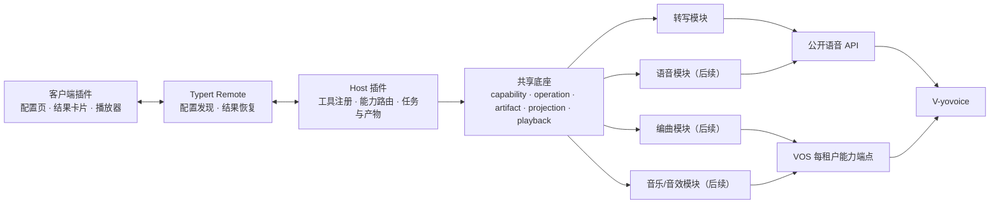
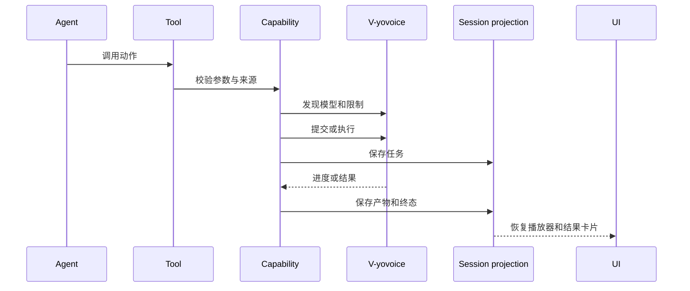

# V-yovoice DSH 插件包设计

## 状态

- 状态：底座已实现，待发布安装验收。
- 首发环境：VOS 上的 v-harness。
- 首发能力：沿用现有音频转写，不新增用户可见功能。
- 目标插件包：`@ictrek/dsh-tool-v-yovoice`。
- 现有包：`@ictrek/dsh-tool-audio-transcription` 迁移后停止并行安装。

## 1. 目标

V-yovoice 对 DSH 只提供一个用户入口、一个安装包和一套配置。用户可以一次安装，在
v-harness 会话中使用 V-yovoice 的转写、语音、编曲、音乐和音效能力，不需要分别寻找
多个插件。

首个版本先建立稳定的底座，不直接扩张功能：

1. 将已跑通的音频转写迁移到新包。
2. 保留现有工具名、配置和会话恢复行为。
3. 抽出所有后续能力共用的服务接入、任务、产物、会话投影、播放和卡片边界。
4. 后续能力按模块追加，不再次拆分插件包。

## 2. 已确认决策

| 决策 | 结论 |
| --- | --- |
| 插件数量 | 一个 V-yovoice 插件，内部模块化 |
| 首发范围 | 只迁移现有转写，不新增 TTS、编曲或音乐 |
| 首发平台 | VOS；桌面端后续适配 |
| 包身份 | 使用最终包名 `@ictrek/dsh-tool-v-yovoice` |
| 现有接口 | 首版保留 `transcribe_audio` 等工具名和现有配置项 |
| 底座范围 | 现在建立能力、任务、产物、会话和播放抽象，不提前实现其他业务协议 |
| 私有接口授权 | 插件不保存 VOS Token；私有 `/studio-api` 通过 v-harness 每租户能力端点访问 |

## 3. 非目标

- 不在首版同时加入语音、编曲、音乐和故事配音。
- 不把每个后端 HTTP 接口映射成一个 DSH 工具。
- 不提供一个要求模型自行拼参数的通用 `yovoice_call(method, params)` 总入口。
- 不重复实现 v-harness 已有的聊天助手、会话管理或文件交付能力。
- 不让插件配置或会话日志持有 VOS access token、refresh token 或任意宿主文件路径。
- 不把转写、语音、音乐拆成多个需要分别安装的插件。

## 4. 总体架构



底座只负责稳定边界；每个业务能力只实现自己的参数、服务调用和展示语义。

## 5. 模块边界

建议目录：

```text
tool-v-yovoice/
  src/
    core/
      capability.ts
      operation.ts
      artifact.ts
      config.ts
      projection.ts
      playback.ts
      remote.ts
      service/
    features/
      transcription/
    client/
      settings.tsx
      cards/
      player.tsx
      locales.ts
```

| 模块 | 职责 | 首版 |
| --- | --- | --- |
| `core/capability` | 能力标识、可用性、发现、校验和执行路由 | 有，只注册转写 |
| `core/operation` | 异步任务状态、进度、错误、取消和幂等键 | 有，转写内部使用完成态任务 |
| `core/artifact` | 音频、文本、乐谱、MIDI 等结果的稳定元数据 | 有，保存转写原文和音频来源 |
| `core/projection` | 会话级结果恢复和长期状态 | 有，兼容现有转写投影 |
| `core/playback` | 受会话授权的媒体播放与下载路由 | 有，复用现有播放器 |
| `core/config` | 服务根地址、能力发现、默认模型和限制 | 有，首版只展示转写字段 |
| `features/transcription` | 现有转写工具、原文分页和失败语义 | 有，完整迁移 |
| `features/speech` | 语音、音色和声音设计 | 后续 |
| `features/score` | 乐谱校验、渲染、分轨和 MIDI | 后续 |
| `features/music` | 音乐、音效、改编和歌词时间轴 | 后续 |

内部模块可以共享代码，但不得让未来功能反向依赖转写模块。

## 6. 基础契约

### 6.1 能力

能力描述“V-yovoice 能做什么”，不直接等于 HTTP 路径：

```ts
type CapabilityId = 'transcription' | 'speech' | 'score' | 'music'

interface Capability {
  id: CapabilityId
  discover(): Promise<CapabilitySnapshot>
  validate(input: unknown): void
  start(input: unknown): Promise<OperationRef>
  poll?(ref: OperationRef): Promise<OperationSnapshot>
  cancel?(ref: OperationRef): Promise<void>
}
```

首版只有 `transcription`。后续能力只能增加新模块，不修改现有转写语义。

### 6.2 任务

所有长耗时生成都使用同一套任务状态。首版转写仍可保持同步工具行为，但内部结果应
表示为已完成的 `Operation`，避免未来重新定义状态模型。

```ts
type OperationState =
  | 'queued'
  | 'running'
  | 'completed'
  | 'failed'
  | 'cancelled'
  | 'timed_out'
  | 'unknown'

interface Operation {
  id: string
  capability: CapabilityId
  state: OperationState
  progress?: number
  error?: { code: string; message: string }
  idempotencyKey?: string
  createdAt: string
  updatedAt: string
}
```

规则：

- 提交前生成稳定的幂等键；相同请求重试不得重复生成。
- 取消请求只表示已发出取消，不虚构远端已经停止。
- 进程重启后，已完成结果可恢复；未完成任务标记为 `unknown`，不得当作成功。
- 客户端展示持久化状态，不依赖重新查询服务才能显示历史结果。

### 6.3 产物

产物描述用户最终可以播放、复制或下载的内容：

```ts
interface Artifact {
  id: string
  kind: 'audio' | 'transcript' | 'score' | 'midi' | 'stems'
  mimeType: string
  bytes?: number
  durationSeconds?: number
  source: string
  playbackPath?: string
  downloadPath?: string
  provenance: {
    capability: CapabilityId
    model?: string
    operationId?: string
  }
}
```

会话日志只保存可 JSON 序列化的元数据和受控媒体标识，不保存任意宿主绝对路径。

### 6.4 配置

对用户仍只有一个服务地址。内部使用按能力分组的规范配置：

```ts
interface Config {
  baseUrl: string
  defaults: {
    transcription?: { model?: string }
    speech?: { model?: string; voice?: string }
    score?: { soundFont?: string }
    music?: { model?: string }
  }
  requestTimeoutMs: number
  maxUploadBytes: number
  maxResponseBytes: number
  pageCharacters: number
}
```

首版继续接受现有的 `baseUrl`、`model`、`requestTimeoutMs`、`maxUploadBytes`、
`maxResponseBytes` 和 `pageCharacters`，并在加载时归一化到新结构。用户不需要重新
填写配置。

## 7. 工具表面

工具按用户动作划分，不按后端端点划分。

首版保留：

| 工具 | 用途 |
| --- | --- |
| `list_audio_files` | 列出当前会话可转写音频 |
| `list_audio_models` | 查询转写模型和就绪状态 |
| `transcribe_audio` | 转写附件或用户明确给出的文件路径 |
| `read_audio_transcript` | 分页读取已保存原文 |

后续新增工具控制在少量稳定动作内，候选为：

| 工具 | 用途 |
| --- | --- |
| `yovoice_status` / `yovoice_models` | 查询能力、模型、音色和就绪状态 |
| `yovoice_voices` | 列出、导入或预览参考音色 |
| `yovoice_speak` | 生成语音 |
| `yovoice_render_score` | 校验并渲染编曲，导出音频、分轨或 MIDI |
| `yovoice_generate_music` | 生成音乐、音效或改编 |
| `yovoice_get_operation` | 查询任务 |
| `yovoice_cancel_operation` | 取消任务 |

新增工具应保持参数少、错误码稳定，并把长任务统一交给任务与产物层。故事配音优先由
语音工具和技能/工作流组合，不急着增加低层专用工具。

## 8. 授权与传输边界

### 公开语音 API

转写、标准 TTS 和公开音色接口可以继续由 Host 直接访问配置的服务根地址。该路径不
携带 VOS 用户令牌，也不需要把服务凭据写入插件配置。

### 私有 VOS 接口

编曲、音乐和用户工作台数据位于 `/studio-api`，需要 VOS 用户身份。此类请求后续通过
v-harness 的每租户能力端点访问，例如：

```text
~/.dsh/yovoice.sock
```

网关持有用户令牌并完成身份注入；插件和智能体只获得该用户范围内的能力。插件配置、
会话日志和工具结果都不得保存 access token 或 refresh token。

v-harness 当前的 scheduler 代理只转发聊天、Responses 和 Messages 路由，不能直接
用来访问音频接口。V-yovoice 能力端点应独立设计，并只放行明确需要的路径。

### 文件边界

- 上传音频只能来自当前会话附件，或用户在对话中明确给出的路径。
- 插件不得读取或返回任意宿主路径。
- 播放和下载必须校验会话、产物和授权关系，支持范围请求，不接受伪造的媒体标识。
- 音色克隆必须由用户明确提供参考音频；界面和工具都要说明用途与保存位置。

## 9. 请求与状态流



首版转写可以同步返回，但仍走参数校验、能力路由、产物保存和会话恢复。后续长任务
使用“提交 → 查询 → 结果卡片”的异步流程。

## 10. 会话状态与播放

为恢复已经发布的转写会话，底座继续使用现有 projection key
`audioTranscription`。该 key 只代表持久化通道，不代表插件仍只支持转写。后续增加字段
时递增 `stateVersion`，不创建平行的第二套会话状态。当前实现已升级到
`stateVersion: 3`，为转写结果增加可选的 `artifact` 元数据，并为后续任务预留
`operation` 字段。

状态至少包含：

- 当前会话的附件和用户引用；
- 已完成任务；
- 产物及来源信息；
- 转写原文和分页位置；
- 上一份成功结果及其失败替代关系。

结果卡片只读取持久化元数据；服务暂时不可达时，已经保存的原文、音频和错误说明仍能
显示。音频播放沿用插件自有的会话授权路由。

## 11. 包迁移与兼容

1. 新包使用 `@ictrek/dsh-tool-v-yovoice`，作为唯一长期安装入口。
2. 旧包发布最后一个带迁移说明的版本，不要求用户保留两个插件。
3. 首版保留 Loader 行标识和设置键 `tool-audio-transcription`，现有 profile 不需要
   重新填写服务地址和模型；插件包名与用户看到的插件名称仍切换为 V-yovoice。
4. 已存在会话通过原 projection key 恢复；当前 `stateVersion` 为 3，旧缓存会从事件
   重新折叠，不丢失转写原文和播放器。
5. 现有 `transcribe_audio` 等工具名和插件播放路由在首版保持不变；后续新增工具使用
   `yovoice_` 前缀。
6. 构建继续锁定明确的 v-harness 源码版本，并记录 DSH 兼容范围。

## 12. 分阶段扩展

| 阶段 | 内容 | 前置条件 |
| --- | --- | --- |
| 0 | 新包底座、现有转写迁移、配置和会话兼容 | 当前转写验收通过 |
| 1 | 语音生成、音色列表、参考音色导入 | 公开 TTS/音色接口稳定 |
| 2 | 编曲校验、渲染、分轨和 MIDI | 私有工作台能力端点可用 |
| 3 | 音乐、音效、改编和歌词时间轴 | 调度、模型许可和长任务验证完成 |
| 4 | 故事配音组合工作流 | 语音模块稳定，确有持久化多角色时间轴需求 |

每个阶段只增加能力模块、工具和卡片，不拆包、不复制底座、不改变已完成能力的调用
语义。桌面端适配作为独立阶段，不与 VOS 首版同时扩大验证面。

## 13. 验收标准

首版完成时必须同时满足：

- 现有转写附件、路径、全文分页和重试行为保持可用。
- 旧配置无需重填；旧会话可恢复原文和音频卡片。
- 插件未配置、服务不可达、模型未就绪时能够加载并给出明确错误。
- 只有一个 V-yovoice 插件入口，不与其他 V-yovoice 转写包同时启用。
- 音频播放、下载和任务结果均经过会话授权，不暴露任意宿主路径。
- 插件和会话中不出现 VOS Token。
- Host、Client、生命周期、播放、配置、迁移和转写测试通过。
- 使用最终发布的 `.tgz` 在目标 v-harness 租户中完成安装和实际调用验证。

## 14. 后续待定

以下细节在对应阶段实现前再定，不阻塞首版底座：

- v-harness `yovoice.sock` 的精确路由白名单和网关改动位置。
- 桌面端本机 API 的授权与数据目录适配方式。
- 将来新增语音等能力时，是否把旧 Loader 行标识正式迁移到 `tool-v-yovoice`。
- 实际使用后是否合并部分查询类工具，以控制上下文占用。

## 15. 实现记录

首个底座候选包位于 `integrations/v-harness/tool-v-yovoice`，版本为 `0.2.1`。

已落地的模块：

- `src/core/config.ts`：服务根地址、能力默认值和公共限制的归一化。
- `src/core/service.ts`：有界 JSON 请求、超时、取消、HTTP 状态与错误详情。
- `src/core/capability.ts`：能力注册表；首版只注册转写。
- `src/core/operation.ts`：同步转写可复用的已完成任务状态契约。
- `src/core/artifact.ts`：可持久化的产物引用；转写结果新增确定性 `artifact` 元数据。
- `src/core/projection.ts`：原转写投影扩展到 `stateVersion: 3`，保留会话恢复。
- `src/core/playback.ts` / `playback-route.ts`：沿用已跑通的会话授权播放与范围请求。
- `src/features/transcription`：原转写工具、控制器、输入选择和错误语义迁移到独立能力模块。
- `src/index.ts`：单插件入口，挂载共享底座、转写模块、配置页、Remote 和播放路由。

首版继续保留 `tool-audio-transcription` 的 Loader 标识、设置命名空间和
`api/tool-audio-transcription/file` 播放路由，避免旧 profile 和已保存会话失效。

构建验证使用固定 v-harness `0.2.2-rc.1.vos.06`
（`d1017fcd06b7aae7a2ceab3f4b8dd51f9def2ab5`）执行
`build:candidate`，通过插件测试、Host/Client 编译、打包和归档审计。最终发布仍须使用
目标租户中的正式 `.tgz` 完成安装和实际调用验收。

### tc207 设备验证

在 tc207（aarch64 / Jetson Orin NX）上使用同版本
`swr.cn-southwest-2.myhuaweicloud.com/ictrek/v-harness:arm_20261113_rc2-vos01`
（镜像 revision 与固定提交一致）启动隔离测试容器，并验证：

- `@ictrek/dsh-tool-v-yovoice@0.2.1` 可通过最终 `.tgz` 安装并启用。
- 插件页显示 V-yovoice、`tool-audio-transcription` 组件处于 Running。
- 在正式 VOS 的 admin profile 中，保存 `http://v-voice-backend:7070` 和
  `sensevoice-int8` 后，重启工作区仍能恢复配置。
- “Check connection / list models” 成功读取模型目录，SenseVoice Small INT8 显示 Ready。

本次已完成正式 VOS 环境中的安装、启用、配置持久化和模型发现验证；对话驱动的实际音频
转写仍待用真实附件完成最终验收。
